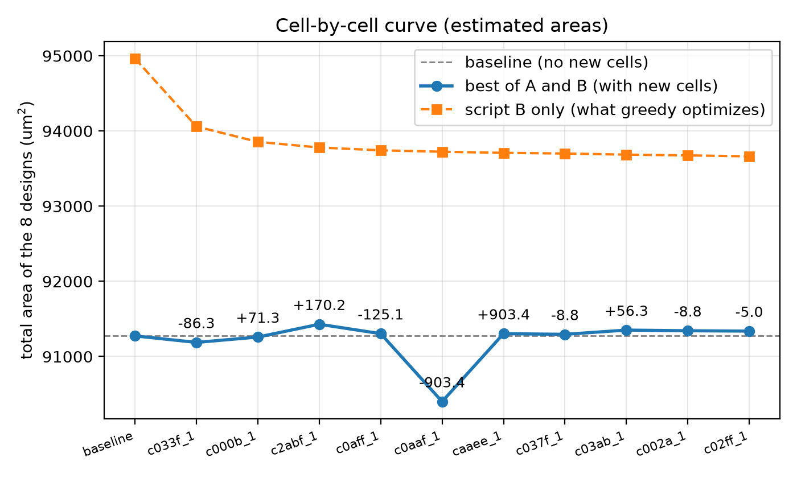
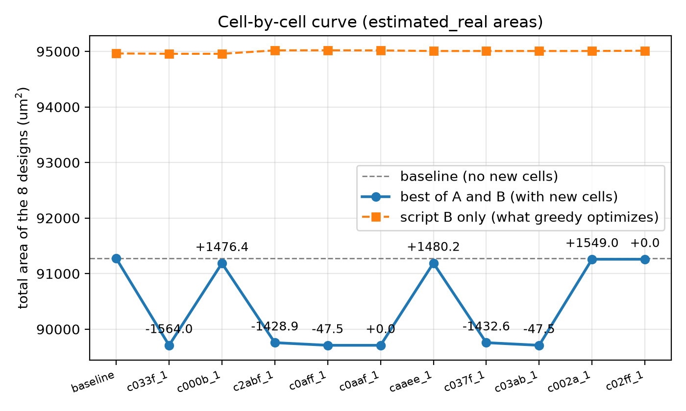

# celladvisor

**Which small functions does a synthesized design compute again and again, that the sky130 HD library has no cell for, and would a cell for them save area?**

celladvisor reads each design as an and-inverter graph, enumerates its cuts of up to four inputs, classifies the truth tables, checks every class against the full sky130_fd_sc_hd (HD) library, estimates the area of the classes HD lacks, selects a final set of cells greedily, and measures the area of every design with Yosys and ABC, with the estimated cell areas and with the real cells from the cell generator.

Project 1, Option 2 (Finding Cells Worth Adding) · CSCE 3304 Digital Design II, Fall 2026 · Group GB3

## Findings at a glance

| | Result |
|---|---|
| **Script B total** (the script that uses the new cells), 8 designs | 94,963.58 to 93,662.33 um2, **-1.37%** with the ten selected cells, mostly one cell: `c033f`, the inverted majority (the carry of an adder), 384 uses, **-904.6 um2** |
| **Best of both scripts** (the area a designer gets) | 91,273.79 to 91,337.60 um2, **0.07% larger**: script A is already smaller than B on 7 of 8 designs and does not use the cells |
| **Real cells from the generator** | all ten are larger than what HD pays for the same function (+7.5 to +120 um2); the mapper uses **none** of them (0 instances); best of both 91,273.79 to 91,258.77 um2 (+0.02%); 6 of 10 pass the generator's checks |
| **A measurement caveat** | script A's area moves by up to **1,564 um2 (1.7%)** when a library gains cells that are never used. Checkpoint 2's 1.70% "saving" was this effect: script A -1.79%, script B +0.14% (section 6.12) |
| **Sensitivity to the estimate** | `c033f` 30% smaller: script B another **-1,072.5 um2** and 318 to 472 instances; its real area is 129% above the estimate |

**Conclusion.** With the generator's real cell sizes, none of the cells our tool proposes reduces the area of any design. With the model's estimated sizes the cells reduce script B's area by 1.4%, but not the best-of-both area. The one candidate that matters is the inverting majority cell; at about 12.5 to 13.8 um2 (35% below the 20.0 um2 the generator draws) the mapper would start to use it.

## 1. Group

| Name | Student ID |
| --- | --- |
| Kareem Rashed | 900233328 |
| Joshua Makar | 900231109 |
| Mahinour Abdelgawad | 900231870 |

Group GB3 (new cells are named `dd2_gb3__...`) · Option 2 · AI used as a development aid (AGENTS.md, `ai/`).

## 2. Quick start

**Tools.** Yosys 0.70+post with its ABC (`yosys-abc`), Icarus Verilog 13.0, Python 3.15.0 (3.11 or newer is enough), Docker 29.6.1 (Colima) for the generator checks and OpenSTA. The handout measured its numbers with Yosys 0.33; section 9 lists what that changes. The Docker image `dd2-cellweaver` adds Netgen 1.5.323, OpenSTA and CUDD (built from their repositories) to the course image `dd2-layout-tools` (Magic 8.3.684, ngspice 47).

    make setup     # links pdk/ and given/ (student pack next to the repository, PDK in ~/.ciel/sky130A)
    make check     # tool versions, PDK link, given files
    make test      # every test, including the broken cases (about a minute)
    make all       # the whole flow; the greedy step alone takes about an hour

`make setup` expects `../DD2_Project1_student_pack/given` and `~/.ciel/sky130A`. Override with `make setup GIVEN=<path> PDK_ROOT=<path>`.

The steps that need the cell generator (real areas, its checks, Table 5 with real cells, OpenSTA) need Docker and the generator checkout (`make cw-setup`, once, with network). `make all` runs them when they are there and prints `SKIPPED ...` otherwise; the results of the tagged run are in `results/`.

**The demo** runs the whole flow on a design you give it, in a few minutes, with the final cells already chosen:

    make demo IN=<design.v> [TOP=<top module>] [SV=1]      # SV=1 for SystemVerilog

## 3. What the tool does

    Verilog --Yosys--> AIG --cuts (<= 4 inputs)--> truth tables --> classes (P, PN)
       --> redundancy vs the full HD library --> cost and area model --> ranking
       --> greedy selection --> cell requests + extended Liberty
       --> map every design (scripts A and B) + cec --> Table 5, curve, delays

One Make target per step of the Option 2 handout, section 4:

| Step | What happens | Target | Output |
| --- | --- | --- | --- |
| 1 | AIG of each design: raw, structurally hashed (`strash`), after ABC restructuring (`strash; dch; strash`) | `make aigs` | `build/aig/`, `results/aig_sizes.csv` |
| (2) | Handout Table 1: the six required designs on the usable and reduced HD libraries, scripts A and B | `make table1` | `results/table1.csv` |
| 2 | Cuts of up to 4 inputs, bottom-up over the AIG, all of them (no priority cuts) | `make cuts` | `results/cut_counts.csv` |
| 2, 3 | Truth table of every cut; classes up to input order (P) and up to input order and output inversion (PN) | `make candidates` | `results/class_counts.csv` |
| 5 | Each class against the full HD library: Exists, Exists with an inverter, Contained, New (Table 3) | `make candidates` | `results/candidates.csv`, `candidates_kept.csv` |
| 4, 6 | CMOS cost of each class; area model fitted on HD's x1 cells | `make area-model` | `results/area_model.csv` |
| 7 | Ranking: what HD pays now for each function against the new cell's estimated area, times frequency | `make rank` | `results/ranked.csv` |
| 8 | Cell requests (Appendix A) and the extended Liberty file, checked by Yosys | `make liberty`, `make table5-final` | `libs/`, `results/requests*/` |
| 9 | Map every design with and without the new cells, scripts A and B, every mapping checked with ABC's `cec` | `make table5`, `make table5-final`, `make table5-real` | `results/final_estimated/`, `results/final_real/` |
| 10 | Greedy selection of the final set | `make greedy` | `results/greedy_estimated.csv`, `libs/final_estimated.csv` |
| 11 | Real cells: real area of each final cell and the generator's own checks | `make real-areas-final`, `make check-cells` | `results/real_areas.csv`, `results/real_cell_checks.csv` |
| 12 | The 30% test, and the cell-by-cell curve | `make sensitivity`, `make curve` | `results/sensitivity.csv`, `results/curve_*.csv` and `.png` |
| 9 (report) | Worst path delay of every mapped netlist with OpenSTA | `make delays-final` | `results/delays_final_*.csv` |

**Two rules in the greedy selection that the handout does not state.** It scores each trial by the **script B** total, because script A's area changes with the library even when no new cell is used (section 6.12). And it only accepts a cell if the cells of the library **appear in the mapped netlists**; a cell that is never used cannot save area, and its apparent saving is noise. The selected cells are then evaluated on both scripts and on the best of both.

Module interfaces and owners: [docs/interfaces.md](docs/interfaces.md).

## 4. Commands

| Command | Input | Output |
| --- | --- | --- |
| `make aigs` | `given/designs/`, `designs/` | AIGs in `build/aig/`, `results/aig_sizes.csv` |
| `make table1` | the six required designs, both given libraries | `results/table1.csv`, with the handout's numbers and the difference |
| `make hd-table` | `HD_LIB` | `results/hd_classes.csv`: every HD cell of up to 4 inputs with its truth table and classes |
| `make contained-table` | `HD_LIB` | `results/contained_table.csv` |
| `make cuts` | `build/aig/` | `results/cut_counts.csv` |
| `make candidates` | `build/aig/`, `HD_LIB` | `results/class_counts.csv`, `candidates.csv`, `candidates_kept.csv` |
| `make area-model` | `HD_LIB`, `SPICE` | `results/area_model.csv` and the fit's error |
| `make rank` | `results/candidates_kept.csv` | `results/ranked.csv` (all kept classes) |
| `make liberty`, `make new-cells GROUP=b3 N=5` | `results/ranked.csv` | `libs/new_cells.csv`, `libs/hd_extended.lib`, `results/requests/` (checkpoint 2's five cells) |
| `make table5` | the designs, `libs/hd_extended.lib` | `results/table5.csv`, `table5_best.csv`, `results/mapped/` (checkpoint 2) |
| `make greedy` | `results/ranked.csv`, the 8 designs | `results/greedy_estimated.csv`, `_trials.csv`, `.txt`, `libs/final_estimated.csv` |
| `make table5-final` | `libs/final_estimated.csv` | `libs/hd_final_estimated.lib`, `results/final_estimated/` |
| `make table5-real` | `libs/final_estimated.csv`, `results/real_areas.csv` | `libs/final_real.csv`, `libs/hd_final_real.lib`, `results/final_real/` |
| `make sensitivity` | `libs/final_estimated.csv` | `results/sensitivity.csv` (first cell 30% smaller) |
| `make curve` | `libs/final_estimated.csv` | `results/curve_estimated.csv`, `.png` and `curve_estimated_real.*` |
| `make cw-setup` | network, once | checks out the cell generator, makes `build/cwvenv` |
| `make real-areas`, `make real-areas-final` | the generator | `results/real_areas.csv` (all ranked classes, or only the final cells) |
| `make docker-images` | Docker, network | the images `dd2-layout-tools` and `dd2-cellweaver` |
| `make check-cells` | `libs/final_estimated.csv` | `results/real_cell_checks.csv` (geometry, DRC, LVS, abutment, simulation) |
| `make delays`, `make delays-final` | mapped netlists | `results/delays*.csv` (OpenSTA) |
| `make real-cells`, `make real-cells-soft` | | the generator steps in full, or guarded as in `make all` |
| `make demo IN=<design.v>` | a design | the flow on that design, files in `build/demo/<design>/` |
| `make clean` | | removes `build/` |

`HD_LIB` is the full HD Liberty (`pdk/libs.ref/sky130_fd_sc_hd/lib/sky130_fd_sc_hd__tt_025C_1v80.lib`), used for redundancy and the area model. `SPICE` is the HD SPICE netlist. `GROUP` is `b3`. Mapping always uses `given/hd_reduced.lib` as the baseline.

## 5. Layout

- `src/`: the tool, one module per step (see `docs/interfaces.md`); `demo.py` is the interview demo
- `scripts/`: shell and helper scripts: AIGs, Table 1, real areas, the generator checks, OpenSTA (`sta_delay.py`, `sta_delay.tcl`)
- `tests/`, `tests/broken/`: the tests and the broken cases each check must fail on (never edited to make a test pass)
- `results/`: every table, netlist, log and figure the report uses
- `libs/`: the Liberty files the tool writes and the CSVs of the cells it adds
- `designs/`: the SPM (Tutorial 4) and the multiplier (Tutorial 2), which are not in `given/designs/`
- `docker/`: the Dockerfile of the generator image (Netgen, OpenSTA)
- `cellweaver/`: the cell generator, a git submodule
- `docs/`: `interfaces.md`, and the cell request and response examples (Appendix A)
- `ai/`: AI use log and AI mistakes log
- `report/`: `report.pdf` and `ai_report.pdf`, with their sources

## 6. Results

Every number below comes from a file in `results/` or `libs/`. All areas are in um2.

### 6.1 Designs and baseline

The six required designs of the handout's Table 2 (`cpu8`, `dsp8`, `arlet6502`, `uart_apb`, `risc8`, `fir10`) and, as handout section 3 asks, the SPM of Tutorial 4 and the multiplier of Tutorial 2. The baseline of every comparison is the reduced HD library (189 cells), mapped with the commands of the handout's section 2 and both ABC scripts: **A** (`amap`) and **B** (`&nf`). A design's area is given per script and as the best of both.

| | script A | script B | best of both |
|---|---|---|---|
| six required designs | 86,636.84 | 90,045.11 | 86,559.27 |
| eight designs | | 94,963.58 | 91,273.79 |

Script A is the smaller of the two on 7 of the 8 designs (script B only on `risc8`).

**Table 1 reproduced** (`results/table1.csv`): 24 areas, usable and reduced library, both scripts. They differ from the handout's by -4.49% to +2.22% (mean absolute 1.81%), because we use Yosys 0.70 and the handout used 0.33. The reduced library costs up to 3.00% more than the usable one with our tools (`fir10`, script A), against the handout's "at most 0.5%".

### 6.2 AIGs (`results/aig_sizes.csv`)

| design | inputs | flip-flops | AND nodes: raw | strash | abc | abc vs raw |
|---|---|---|---|---|---|---|
| cpu8 | 10 | 82 | 932 | 884 | 855 | -8.3% |
| dsp8 | 22 | 72 | 1,677 | 1,361 | 1,303 | -22.3% |
| arlet6502 | 13 | 143 | 2,511 | 2,426 | 2,102 | -16.3% |
| uart_apb | 37 | 330 | 3,551 | 2,215 | 1,746 | -50.8% |
| risc8 | 30 | 696 | 5,480 | 5,211 | 4,865 | -11.2% |
| fir10 | 11 | 176 | 8,217 | 6,492 | 6,385 | -22.3% |
| spm | 35 | 64 | 699 | 380 | 368 | -47.4% |
| mul | 16 | 0 | 606 | 525 | 510 | -15.8% |

The flip-flop counts match the handout's Table 2 for the six required designs; our raw AND counts are 6.6% to 29.3% lower than the handout's.

### 6.3 Cuts and classes (`results/cut_counts.csv`, `results/class_counts.csv`, ABC graph)

| design | AND nodes | cuts (all) | cuts of 2 to 4 leaves | P classes | PN classes | NPN classes |
|---|---|---|---|---|---|---|
| cpu8 | 855 | 6,032 | 5,177 | 202 | 169 | 53 |
| dsp8 | 1,303 | 10,758 | 9,455 | 221 | 180 | 49 |
| arlet6502 | 2,102 | 16,710 | 14,608 | 261 | 185 | 47 |
| uart_apb | 1,746 | 10,372 | 8,626 | 140 | 107 | 30 |
| risc8 | 4,865 | 36,109 | 31,244 | 232 | 168 | 42 |
| fir10 | 6,385 | 66,698 | 60,313 | 240 | 200 | 55 |
| spm | 368 | 1,933 | 1,565 | 35 | 35 | 14 |
| mul | 510 | 5,782 | 5,272 | 185 | 146 | 34 |

"Cuts (all)" includes the trivial one-leaf cut of every AND node. **P classes** are equal up to input order, the class that matters for CMOS: an input inverter costs two transistors, so two functions that differ by an inverted input are two different cells. PN also identifies a function with its complement. **NPN classes** also treat input inversions as free, which counts 2.5 to 5.6 times fewer classes (for `fir10`, 240 P classes against 55 NPN classes) and so overstates how much cells could be shared. The strash graph's counts are in the same file. `canon_npn` finds exactly 222 NPN classes over all 4-input functions (`tests/test_canon.py`).

### 6.4 Redundancy against HD (`results/candidates.csv`, `results/hd_classes.csv`)

The checker reproduces the handout's Table 4 exactly (24 Exists, 20 Exists with an inverter, 38 Contained, 3,822 New, over the 3,904 classes of 4-input functions that use all four inputs), and calls every HD cell of up to 4 inputs Exists (258 cells, 56 distinct P classes). Over the 450 classes of the eight designs (ABC graph):

| Table 3 class | classes |
|---|---|
| Exists | 44 |
| Exists with an inverter | 27 |
| Contained | 33 |
| New | 346 |
| **kept** (Table 3's decision, with the area model's estimate) | **379** |

### 6.5 Area model (`results/area_model.csv`)

Width in sites against transistor count, fitted on HD's x1 cells, one line for single-stage and one for multi-stage cells. Error on the cells it was fitted on:

| | cells | mean error | worst error |
|---|---|---|---|
| single-stage | 27 | 0.22 sites | 1 site |
| multi-stage | 58 | 0.53 sites | 2 sites |

### 6.6 Ranking (`results/ranked.csv`, 379 classes)

Top five by estimated total saving (HD's cost of the function mapped alone against the model's estimate, times the number of cuts):

| class | cuts | HD now | estimated | est. total saving |
|---|---|---|---|---|
| `000b` | 2,330 | 11.26 | 8.76 | 5,830.6 |
| `001f` | 1,480 | 11.26 | 7.51 | 5,555.3 |
| `88a8` | 1,776 | 13.76 | 11.26 | 4,444.3 |
| `00af` | 3,183 | 8.76 | 7.51 | 3,982.6 |
| `88aa` | 1,580 | 11.26 | 8.76 | 3,953.8 |

The ranking is a guess: it maps each function on its own and ignores that cuts overlap. The selection below measures instead.

### 6.7 Greedy selection (`results/greedy_estimated.csv`)

Script B total over the eight designs, 379 candidates, estimated areas; stopped by the 10-cell limit.

| step | cell added | instances | script B total | change vs baseline |
|---|---|---|---|---|
| 0 | (baseline) | | 94,963.58 | |
| 1 | `c033f` | 384 | 94,058.96 | -904.6 |
| 2 | `c000b` | 188 | 93,855.01 | -1,108.6 |
| 3 | `c2abf` | 5 | 93,779.94 | -1,183.6 |
| 4 | `c0aff` | 48 | 93,742.41 | -1,221.2 |
| 5 | `c0aaf` | 106 | 93,723.64 | -1,239.9 |
| 6 | `caaee` | 7 | 93,708.62 | -1,255.0 |
| 7 | `c037f` | 2 | 93,699.87 | -1,263.7 |
| 8 | `c03ab` | 15 | 93,684.85 | -1,278.7 |
| 9 | `c002a` | 5 | 93,674.84 | -1,288.7 |
| 10 | `c02ff` | 5 | 93,662.33 | -1,301.2 |

`c033f` is class `033f`, the inverted majority of three inputs: the carry of an adder as one inverting stage of 10 transistors. HD has the non-inverting `maj3_1`, so a design pays `maj3_1` plus an inverter (13.76 um2). It saves **852 um2 in `fir10`** (343 of its 384 uses). From the third cell on, each step is within the noise of script B (about 250 um2, section 6.12). Every trial is in `results/greedy_estimated_trials.csv`.

### 6.8 The final cells, real areas and the generator's checks (`results/real_areas.csv`, `results/real_cell_checks.csv`)

| cell | estimated | real | sites | layout | HD cost | geometry, DRC, LVS, abutment | simulation |
|---|---|---|---|---|---|---|---|
| `c033f` | 8.76 | 20.02 | 16 | shared | 12.51 | pass | pass |
| `c000b` | 8.76 | 23.77 | 19 | shared | 11.26 | pass | **fail** |
| `c2abf` | 12.51 | 137.63 | 110 | isolated | 17.52 | pass | **fail** |
| `c0aff` | 7.51 | 21.27 | 17 | shared | 8.76 | pass | pass |
| `c0aaf` | 11.26 | 23.77 | 19 | shared | 12.51 | pass | pass |
| `caaee` | 8.76 | 27.53 | 22 | shared | 11.26 | pass | pass |
| `c037f` | 10.01 | 36.28 | 29 | shared | 13.76 | pass | **fail** |
| `c03ab` | 8.76 | 25.02 | 20 | shared | 10.01 | pass | pass |
| `c002a` | 8.76 | 23.77 | 19 | shared | 11.26 | pass | **fail** |
| `c02ff` | 8.76 | 18.77 | 15 | shared | 11.26 | pass | pass |

**6 of the 10 pass every check.** The four that fail only fail the generator's logic simulation (an output that rises too slowly); their layouts pass. Every real cell is larger than HD's cost for the same function, by +7.5 (`c033f`, `c02ff`) to +120 um2 (`c2abf`, which fell back to the isolated layout; the other nine use the shared-diffusion layout).

### 6.9 Table 5: best of both, 8 designs, 32 mappings each, all `cec` pass

| design | baseline | with the cells, estimated areas | reduction | with the cells, real areas | reduction |
|---|---|---|---|---|---|
| cpu8 | 4,195.27 | 4,194.02 | +0.03% | 4,187.77 | +0.18% |
| dsp8 | 5,794.31 | 5,833.09 | -0.67% | 5,791.80 | +0.04% |
| arlet6502 | 9,320.19 | 9,333.95 | -0.15% | 9,316.44 | +0.04% |
| uart_apb | 12,817.29 | 12,827.30 | -0.08% | 12,817.29 | 0.00% |
| risc8 | 28,109.46 | 28,121.97 | -0.04% | 28,108.21 | 0.00% |
| fir10 | 26,322.75 | 26,326.50 | -0.01% | 26,322.75 | 0.00% |
| spm | 2,869.00 | 2,869.00 | 0.00% | 2,869.00 | 0.00% |
| mul | 1,845.52 | 1,831.76 | +0.75% | 1,845.52 | 0.00% |
| **total** | **91,273.79** | **91,337.60** | **-0.07%** | **91,258.77** | **+0.02%** |

A negative reduction means the area got larger. The full table, with both scripts and the number of new-cell instances per run, is in `results/final_estimated/table5.csv` and `results/final_real/table5.csv`; the best-of-both rows in `table5_best.csv` of the same folders. Instances: **717** with the estimated areas (570 of them in `fir10`, script B), **0** with the real areas.

**Same script against best of both.** Script B alone improves in several designs with the estimated cells (`fir10` +3.95%, `mul` +2.99%, `dsp8` +0.76%, `cpu8` +0.52%, `arlet6502` +0.39%), but script B stays above script A, so the best-of-both area does not move. For `mul` the best-of-both +0.75% is script A's change with zero new cells used in it. The real-cells library is the ten cells with their real areas, including the four that fail the simulation check; none is used.

### 6.10 Cell by cell (`results/curve_estimated.csv`, `results/curve_estimated_real.csv`)

The total after adding the final cells one at a time, in greedy's order. Solid: best of both. Dashed: script B only (the numbers greedy optimized).

With the estimated areas the script B line falls from 94,963.58 to 93,662.33 (-1.37%), while best of both ends at 91,337.60 (0.07% above the baseline of 91,273.79). The best-of-both dip at the fifth cell (-903.4 um2) is reversed exactly by the next one (+903.4 um2), though that cell is used 7 times: it is script A changing with the library. With the real areas script B stays between 94,957 and 95,019 (no cell is used) while best of both swings between 89,709.79 and 91,273.79 (**-1,564.0 um2, -1.71%**).

### 6.11 The 30% test (`results/sensitivity.csv`)

`c033f`, the first selected cell, made 30% smaller in the Liberty (8.76 to 6.13 um2); all eight designs remapped with script B and the ten cells.

| design | before | after | instances |
|---|---|---|---|
| fir10 | 27,792.91 | 26,845.26 | 288 to 414 |
| dsp8 | 6,055.81 | 5,981.49 | 19 to 34 |
| mul | 1,950.62 | 1,922.34 | 9 to 16 |
| **total** | **93,662.33** | **92,589.81** (-1.15%) | **318 to 472** |

ABC sees only the numbers in the Liberty, so the result depends strongly on the area estimate. The real area of `c033f` (20.02 um2) is 129% above its estimate, far outside this 30%. Even at 30% smaller, `fir10` on script B (26,845) stays above script A without any cell (26,323).

### 6.12 Why the checkpoint 2 saving was not one

Adding a cell to the library changes script A's mapping even if the cell is never used. The real-area curve shows it (above): the cells are not used, yet best of both moves by 1.7%. Checkpoint 2's best-of-both saving of **1.70%** (86,559.27 to 85,089.11, six designs, five cells, estimated areas) splits by script (`results/table5.csv`):

| script | baseline | with five cells | change | cell instances |
|---|---|---|---|---|
| A | 86,636.84 | 85,089.11 | -1.79% | 91 |
| B | 90,045.11 | 90,172.73 | +0.14% | 308 |

So the saving came from script A, and where the cells were really used (script B) the area got slightly worse. Script B itself moves by about 250 um2 when a cell is added and not used (`results/greedy_real_trials.csv`), which is why a saving smaller than that is not evidence. The cause is not known; the effect is deterministic on one machine and differs between machines.

### 6.13 Worst path delay (OpenSTA, `results/delays_final_estimated.csv`, `results/delays_final_real.csv`)

Worst data arrival time of the mapping with the smaller area on each side (best of both), in ns, HD Liberty (typical corner, 1.8 V, 25 C), ideal wires.

| design | baseline | estimated cells | real cells |
|---|---|---|---|
| cpu8 | 4.11 | 4.15 | 4.09 |
| dsp8 | 4.97 | 5.14 | 4.97 |
| arlet6502 | 6.94 | 6.52 | 7.02 |
| uart_apb | 3.93 | **6.10** | 3.93 |
| risc8 | 24.77 | 24.88 | 24.77 |
| fir10 | 7.08 | 7.05 | 7.08 |
| spm | 0.81 | 0.73 | 0.81 |
| mul | 4.59 | 4.44 | 4.59 |

The new cells' timing in our Liberty is a placeholder (0.10 and 0.08 ns), so a path through a new cell is only approximate. `uart_apb` with the estimated cells is 55% slower with no area saving; the other designs change by less than 0.5 ns, in either direction.

## 7. Tests

`make test` runs every file below (about a minute). All pass.

| Test file | What it checks | Broken case |
| --- | --- | --- |
| `tests/test_aig_reader.py` | the AIGER reader | |
| `tests/test_canon.py` | input permutation, class IDs, used inputs; exactly 3,904 classes of 4-input functions that use all 4 inputs; NPN merges nand, nor, and, or; exactly 222 NPN classes of 4-input functions | |
| `tests/test_cuts.py` | cut enumeration: dominated cuts removed, size limit, the hand-traced cuts and truth tables of a tiny AIG | |
| `tests/test_cut_check.py` | the cut check accepts a correct truth table and rejects a wrong one | `tests/broken/wrong_cut_tt.json` on `tests/broken/small_aig.aag`: one bit flipped |
| `tests/test_hdlib.py` | the Liberty expression parser and the HD class table | |
| `tests/test_contained.py` | the Contained table: nand3 with a pin tied high is nand2, the cheapest drive is kept | |
| `tests/test_redundancy_check.py` | every HD cell of up to 4 inputs is Exists; the handout's `0x077F` is New | `tests/broken/hd_cell_as_candidate.json`: nand2_1 must be Exists |
| `tests/test_table4.py` | the handout's Table 4: 24 Exists, 20 Exists with an inverter, 38 Contained, 3,822 New | |
| `tests/test_cost.py` | nand2 4, aoi21 6, the handout's majority cell 12 transistors; and2 and xor2 multi-stage; agrees with the area model's single-stage test on all 65,536 functions | |
| `tests/test_areamodel.py` | transistor counts from SPICE; the single-stage test; 12 transistors give 8 sites; mean error under 1 site | |
| `tests/test_liberty_writer.py` | the writer reproduces the handout's example cell exactly; its request is `0x077F` (Appendix A); the extended library loads in Yosys | `tests/broken/liberty_missing_brace.lib` and `tests/broken/liberty_unknown_pin.lib` |
| `tests/test_cec.py` | `cec` passes cpu8 mapped with script A | `tests/broken/cec_swapped_gate.json`: one nand2_1 replaced by nor2_1 must fail `cec` |
| `tests/test_sensitivity.py` | only the named cell's area changes, the order of the cells is kept | an unknown cell is refused |

The generator checks (`make check-cells`), the delay script and `make demo` are verified by running them; their results are in `results/`.

## 8. AI use

AGENTS.md · ai/use_log.md · ai/mistakes_log.md · report/ai_report.pdf

## 9. Limitations

- **Yosys version.** We use 0.70, the handout 0.33. Our areas differ from the handout's by up to 4.5% and our AND counts are lower; the reduced library costs script A up to 3.0% instead of under 0.5%.
- **Script A is not stable.** Its area changes with the library even when no new cell is used (up to 1,564 um2, 1.7%), and differs between machines with the same Yosys version. All numbers in this README come from one machine and one run. The greedy selection may pick other cells on another machine; `make all` then follows its own selection, and the generator steps are guarded (section 2).
- **Selection on script B.** The handout does not say which script's area greedy uses; we use script B, and evaluate the final set on both scripts and on the best of both. The selection's total covers eight designs (the six required plus the SPM and the multiplier).
- **Estimated against real areas.** The area model describes HD's hand-optimized layouts. The generator's cells are 2.1 to 3.6 times the model's estimate (11 times for `c2abf`) and 1.6 to 2.6 times what HD pays for the same function (8 times for `c2abf`). The model's error on HD's own cells is under one site.
- **The generator.** 14 of the first 30 ranked candidates could not be laid out (routing capacity exceeded). 4 of the 10 final cells fail its logic simulation check; the real-cells library nevertheless contains all ten, and none is used. We did not run its full characterization, so the new cells have placeholder timing and capacitance (handout section 6).
- **Cost.** The limit of 3 transistors in series is not enforced in the cost estimate, so `nand4` counts as one stage; Table 4's rows below the four redundancy counts (one-stage classes) are not tested. Multi-stage costs are a rough estimate; XOR-like functions get a fixed 40 transistors.
- **Ranking** maps each function alone and multiplies by its frequency. Cuts overlap, so not every occurrence can be replaced at once. The pool is every kept class of the ABC graph; classes that occur rarely are in it, but a larger design set could change the ranking.
- **cec** compares each mapped netlist with the design after Yosys synthesis and flip-flop mapping (before ABC), not with the Verilog source; flip-flops are matched by order. Tutorial 4's gate-level testbenches are not run.
- **Delays.** Ideal wires (no parasitics), typical corner, placeholder timing for the new cells.
- **Designs.** `pic16`, `p16c5x` and the optional designs are not part of the tables; `make demo` runs the flow on any of them.
- **Noise floor.** Script B moves by about 250 um2 when a cell is added and not used, so selection steps below that (the last eight cells) are not evidence of savings.

## 10. Third-party files

| What | Source | Licence / note |
| --- | --- | --- |
| `given/` (student pack), `pdk/` (sky130A) | linked by `make setup`, not copied | course files, SkyWater PDK |
| `designs/spm.v` (SPM, CSADD, TCMP of Tutorial 4, joined in one file) | Tutorial 4, Mohamed Shalan | Apache License 2.0 (header kept) |
| `designs/mul.v` (8-bit signed multiplier) | Tutorial 2, Mohamed Shalan | header names the author; no licence text in the file |
| `cellweaver/` | the instructor's cell generator (https://github.com/shalan/cellweaver), a git submodule | see its repository |
| Netgen 1.5.323, OpenSTA, CUDD in `docker/cellweaver.Dockerfile` | built from their public repositories inside the image | see each repository; not committed |
